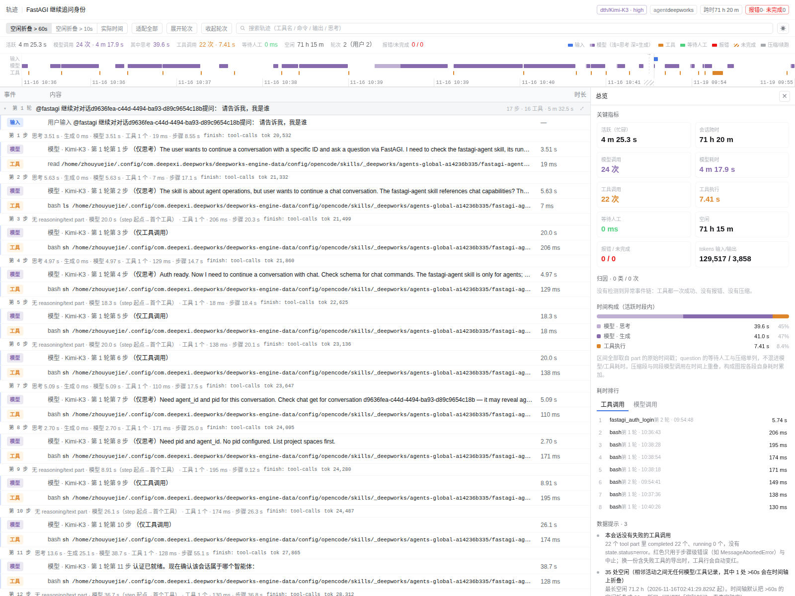

# sesscope

**把本机 Agent 的会话读成同一份领域模型，回答三个问题：时间花在哪、哪一步卡住、失败后为补救多花了多少步。**

只读 · 离线 · 不调模型 · 单个静态二进制



## 为什么需要它

Agent 排障最常卡在三件事上，而且都不是"再看一眼日志"能解决的：

1. **时间算不清**：一轮对话实际跑了 4 分钟，页面上跨时 71 小时——慢在模型、慢在工具、还是人在等？
   不同产品的字段口径还不一样（有的把等待人工算进工具耗时，有的不写结束时间）。
2. **代价说不明**：一次授权失败之后有 32 步都在补救，这 8 分钟该记在谁头上？
   会话里只有"发生了什么"，没有"为此付出了多少"。
3. **经验会作废**：换一个 Agent 产品，之前那套"看哪个字段、怎么算耗时"的经验全部重来。

sesscope 的做法是：**先把四个产品的存储都映射成一份领域模型，再只写一份派生算法**，
所以换产品不用换口径，也不用重写归因规则。

## 它是什么 / 不是什么

| 是 | 不是 |
|---|---|
| 事后解剖器：读取已经落盘的会话 | 采集器：不埋点、不挂钩子、不写任何存储 |
| 跨产品统一视图：opencode / dsh / codex / claude | 单产品专用工具（名字不再绑定任何一家） |
| 确定性归因：结构化字段 + 序列规则 | 会替你调用模型的分析器（零网络、零 token） |
| 可分享的产物：自包含 HTML + 规范 JSON | 实时监控 / 分布式 tracing / TUI |

## 支持哪些来源

四个适配器实现同一套接口；能力差异用**能力位**显式声明，缺能力会变成诊断，不会用 0 或空串冒充。

| 能力 | opencode | dsh | codex | claude |
|---|---|---|---|---|
| 进程发现（/proc） | ✅ | — | — | — |
| 原生工作区 | ✅ project | 目录分组 | 目录分组 | 目录分组 |
| 标题 | ✅ 存储内 | ✅ session/title | 派生（首条人类输入） | 派生（首条人类输入） |
| 轮次/步骤编号 | 派生 | ✅ turn/step | ✅ turn_id | ✅ turnPosition |
| token 用量 | ✅ | ✅ | ✅ | ✅ |
| 思考文本 | ✅ | ✅ | ❌ 加密（有诊断） | 视是否开启 |
| 工具参数/结果 | ✅ | ✅ | ✅ | ✅ |
| 工具状态 | ✅ 存储内 | ✅ isError | 推断（有诊断） | 推断（有诊断） |
| 压缩记录 | ✅ | ✅ v4 | ✅（无耗时） | — |
| 结构化错误 | ✅ | ✅ | 部分 | ✅ |

本机实测规模：opencode 52 个会话、dsh 314 个、codex 88 个、claude 19 个。

## 快速开始

需要 Go 1.21+（不需要 cgo）。

```bash
make build            # → out/sesscope（约 10 MB，UI 已内嵌）
```

四步走，不需要知道任何存储路径：

```bash
sesscope sources                        # 1. 有哪些来源、存储在哪、能不能读
sesscope sessions --limit 20            # 2. 跨来源列会话（拿到 id）
sesscope export --session <id> --html trace.html   # 3. 导出 + 出页面
sesscope analyze --session <id>         # 4. 确定性归因
```

真实输出（`sources`，本机）：

```
SOURCE    STATUS       FORMAT                 STORE                                        SESSIONS  LIVE       NOTE
opencode  ok           opencode/sqlite:v1     ~/.config/…/opencode/opencode.db                   52  pid 23753  旧版 schema
opencode  unsupported  opencode/sqlite:v2     ~/.local/share/opencode/opencode.db                -  pid 23753  新版 schema
dsh       ok           dsh/jsonl:v3+v4        ~/.dsh/sessions                                   314  -          另含 53 个 v3 会话
codex     ok           codex/rollout:rollout  ~/.codex/sessions                                  88  -          思考内容加密
claude    ok           claude/jsonl:jsonl     ~/.claude/projects                                 19  -          无标题/无压缩记录
```

`analyze` 输出（真实数据，节选）：

```
补偿链（一次故障引发的连续补救区间）

区间               步数       耗时  性质                                                        结果
第 1 轮 3-34 步      32    8 m 1 s  授权/登录补偿链（CLI 跑不通 → 探目录 → 读脚本 → 重建环境）  最后一次失败在第 33 步

按原因聚合（窗口耗时＝从触发到恢复的时间窗，是代价上限）

原因              次数   窗口耗时  置信度
工具报错            10  15 m 30 s  A
同一目标重复失败      3   1 m 58 s  A
输出编码损坏（乱码）   1      2.9 s  A
```

## 命令

| 段 | 命令 | 作用 |
|---|---|---|
| 发现 | `sources` | 每源每存储的状态、格式版本、会话数、运行中进程；`--explain` 打印"凭什么选它" |
| 发现 | `doctor` | 逐存储体检；`--drift` 抽样报告代码不认识的记录类型 |
| 发现 | `workspaces` | 工作区（跨源 + DeepWorks 应用态叠加） |
| 发现 | `sessions` | 跨源会话列表：`--workspace / --grep / --since / --sort / --limit / --all` |
| 取数 | `export` | 会话 → 规范 JSON；可顺带 `--html` / `--data`；`--format legacy` 出旧 opencode 形状 |
| 分析 | `analyze` | 事件链 + 补偿链 + 证据；`--in` 读导出 JSON，`--session` 直连来源 |
| 渲染 | `render` | 导出 JSON（新旧格式都认）→ 自包含 HTML |
| 元 | `version` / `help` | 版本 + 各源能力摘要 / 帮助 |

约定：会话 id 支持前缀，跨来源歧义时列候选并退出码 2（**不猜**）；
`--session dsh:session-abc` 可显式指定来源；退出码 `0` 成功 / `1` 运行期 / `2` 输入问题 / `3` 来源或格式不支持。

完整契约见 [docs/cli.md](docs/cli.md)。

## 输出

**页面**（`--html`）：顶部三泳道时间轴（条长=耗时，红=报错，琥珀=未完成，绿=等人工，空闲可折叠），
中部按轮次组织的台账，右侧检查器（LLM 输出 / 思考 / 工具参数与结果 / 每个 part 的计时 / 归因），
另有耗时排行与「数据提示」。单文件自包含，可以直接发给别人。

**规范导出**（`export` 默认）：

```json
{
  "schema": "sesscope/session.v1",
  "generated_at": "2026-11-21T09:12:04.130Z",
  "session": {
    "ref":   { "source": "dsh", "store": "~/.dsh/sessions", "id": "session-…" },
    "meta":  { "directory": "/work/demo", "agent": "ptc", "model": {…}, "provenance": {…} },
    "messages": [ { "role": "user", "turn_hint": { "turn": 1 }, "parts": [ … ] } ],
    "diagnostics": [ { "code": "mtime-updated", … } ]
  }
}
```

不带预计算统计：页面数据由 render/analyze 现算，避免两份口径漂移。
旧格式（opencode 的 `export_info/session/global_stats/messages`）仍然可读，`render/analyze` 自动判别。

**`--json`** 统一外壳 `{"schema":"sesscope.<命令>.v1","result": …}`，字段只增不改名。

## 不静默降级

缺能力、推断、截断、文件不完整，都必须说出来——在 CLI stderr、页面「数据提示」、`doctor` 三处可见：

| 代码 | 含义 |
|---|---|
| `torn-tail` | 文件尾部不完整（会话可能正在写） |
| `truncated-text` | 文本/工具输出按上限截断 |
| `mtime-updated` | 列表的 UPDATED 取自文件修改时间 |
| `encrypted-reasoning` | 思考内容加密，本来源不提供 |
| `derived-tool-status` | 工具状态是推断的（源不写状态） |
| `derived-turn` | 轮次由 role 记录派生（缺显式轮次锚） |
| `synthetic-turn-input` | 补了占位用户输入（文件里没有 user/message） |
| `compaction-no-duration` | 压缩没有耗时 |
| `ignored-record-types` | 出现未注册的记录类型（`doctor --drift` 可查） |

同理：新版 schema 会被标成 `unsupported`（读它退出码 3），而不是返回 0 个会话。

## 设计

三层，各管一段，谁也不越界：

```
Source.Open() ─► session.Session ─► trace.Normalize() ─► trace.Data ─► RenderHTML()
  (四个适配器)      (领域模型)          (唯一派生算法)       (页面契约)      (页面)
                                      └── attribution.Analyze ──┘
```

- **为什么分开**：四个来源共同的只有消息/部件/时间/状态；轮次、步骤、统计、归因都是派生语义。
  放进适配器会变成四份"差不多但不一样"的算法，放进视图层则换源不用改页面。
- **工具语义**（`internal/session/toolsem`）：归因判断的是"读了哪个文件、跑了什么命令"，
  所以工具统一带 `Kind`（shell/read/write/edit/search/ask…）+ `Target` + `Command`，
  规则不再绑死产品名（opencode 的 `bash`、codex 的 `exec_command`、claude 的 `Bash` 等价）。
- **归因不调用模型**：只用结构化字段（error/status/tokens/compaction）＋序列模式，
  A 级=结构化字段、B 级=结构化+序列；纯文本只做证据引用，不参与判定。

细节见 [docs/session-model.md](docs/session-model.md)（领域模型、不变量、诊断字典）
与 [docs/sources.md](docs/sources.md)（四个来源的发现契约、字段映射、已知缺口）。

## 架构

```
main.go                     只做装配
internal/cli/               cobra 框架：分组、退出码、旧参数兼容、表格/JSON/时间格式化
internal/cmd/               命令层：只翻译参数 → 调 app
internal/app/               用例层：定位→取数→派生→输出
internal/session/           领域模型（纯类型）+ toolsem
internal/source/            Source 接口、能力位、Store/Locator/Query、共享过滤排序、前缀解析
internal/source/{opencode,dsh,codex,claude}/   四个适配器
internal/source/jsonl/      逐行读 + zstd + torn tail 容忍
internal/trace/             视图层：旧导出适配、Normalize、渲染、页面资源
internal/attribution/       确定性归因
internal/export/            规范导出 sesscope/session.v1
internal/deepworks/         应用态工作区（叠加层）
internal/table/             CJK 宽度对齐
```

依赖方向单向：`main → cmd → cli`；`app → {source, export, trace, attribution}`；
`trace → session`；`source/<agent> → {source, session, zstd}`。
两条硬约束：**`cli` 不认识任何领域类型**（换框架业务零改动）、**`trace` 不认识 `source`**（页面里不判断"这是哪家产品"）。

## 开发与验证

```bash
make verify     # gofmt + go vet + go test
make smoke      # 真机四源端到端：每源导出 1 个会话 + 页面冒烟，报告写 out/smoke/report.json
make sources    # 带 --explain 的来源清单
make doctor     # 体检 + 未注册记录
```

测试分四层：**黄金用例**（opencode 导出 → 页面数据逐字节 + HTML 指纹 + 10 项统计数字）、
**等价性**（直连库与旧导出产出的页面数据必须逐字节相同）、
**适配器夹具**（dsh/codex/claude 各自用 map 构造 fixture，测试时现场压 zstd）、
**CLI 契约**（每条命令的 `--help`、退出码、`--json` 的 schema、旧单横线参数兼容、歧义/不支持/未发现三种失败路径）。

页面另有 CDP 自检：`node tools/cdp-check.mjs --html <页面>`（钉死会话的完整回归）、
`node tools/cdp-smoke.mjs --html <页面>`（任意会话的冒烟）。

## 已知限制

- opencode 新版 schema（`session_v2/session_message/session_part`）只做了识别与如实报错，读取映射尚未实现（本机该库 0 会话）。
- 文件型来源（dsh/codex/claude）的列表 UPDATED 取自文件修改时间；消息数未知时显示 `-`，不为列个数字去全扫。
- codex 的思考内容多为加密；工具状态与起止时间由"是否出现输出记录"推断（有诊断）。
- claude 本机样本未出现 thinking / compaction，能力位按"不保证"处理。
- 大会话没有虚拟滚动：几百条消息没问题，再大需要优化。

## 路线图

1. opencode v2 schema 读取映射（含夹具）。
2. 跨源 conformance 共享套件 + 假 HOME 夹具 E2E（当前是每源独立夹具 + 真机 smoke）。
3. 页面显示来源徽标与诊断入口（`provenance` 已在导出里，页面尚未展示）。
4. codex 子会话关系、claude thinking/compaction 的实机证实。

## 许可

尚未添加 LICENSE 文件。要开源的话告诉我用 MIT 还是 Apache-2.0，我补上并更新本节。

---

命名：`sesscope` = session + scope——观察会话，而不是只为某一个产品记录会话。
